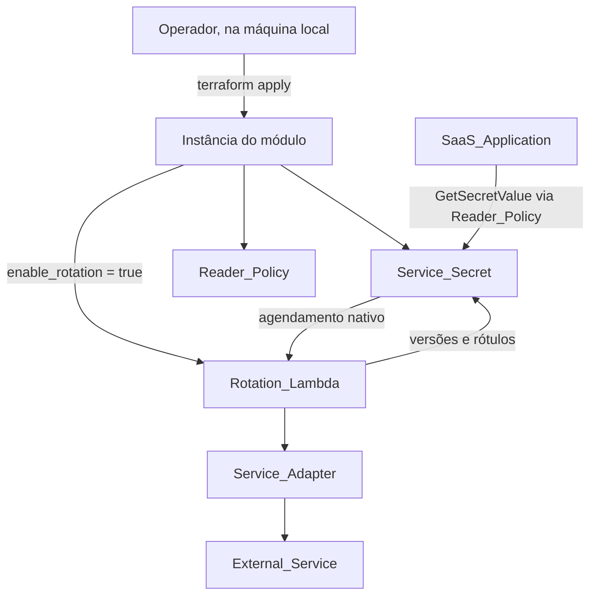
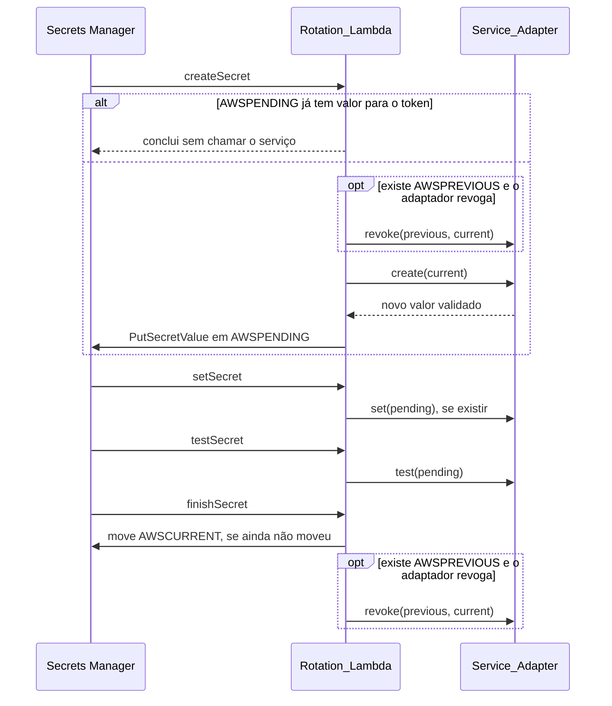

# Design Document

## Overview

O núcleo do NexusKey é um módulo Terraform com uma instância por serviço. Toda instância cria um segredo no Secrets Manager e uma política de leitura. Com `enable_rotation = true`, ela também cria a Lambda de rotação e o agendamento nativo.

### Objetivos de design

- **Uma fonte de estado:** versões e rótulos do Secrets Manager (`AWSPENDING`, `AWSCURRENT`, `AWSPREVIOUS`) substituem qualquer armazenamento adicional.
- **Núcleo independente de serviço:** `rotation.mjs` conhece só as etapas; o que é específico fica em um adaptador.
- **Falha segura:** a credencial atual só muda depois de a nova passar no teste.
- **Sem valor no state:** o valor inicial entra por variável `ephemeral` e argumento write-only.
- **Só o necessário:** não há código para necessidades que nenhum serviço atual tem, como credencial de plataforma.

---

## Architecture



### Fluxo de rotação



---

## Components and Interfaces

### Terraform

| Arquivo | Recurso | Quando |
|---|---|---|
| `main.tf` | `aws_secretsmanager_secret.this`, nome `nexuskey/<service_name>` | Sempre |
| `main.tf` | `aws_secretsmanager_secret_version.initial`, com `secret_string_wo` e `ignore_changes = [version_stages]` | `initial_secret_version > 0` |
| `main.tf` | `aws_iam_policy.reader`, só `GetSecretValue` no ARN do segredo | Sempre |
| `iam.tf` | Role e duas políticas inline | `enable_rotation` |
| `lambda.tf` | `archive_file`, grupo de logs e `aws_lambda_function` (`nodejs24.x`, 300 s), com `SERVICE_NAME` no ambiente | `enable_rotation` |
| `rotation.tf` | `aws_lambda_permission` (`source_arn` do segredo) e `aws_secretsmanager_secret_rotation` (`rotate_immediately = false`, `depends_on` no valor inicial) | `enable_rotation` |

- **Removidos:** `eventbridge.tf`, o parâmetro SSM, a política SSM e as variáveis `secret_arn`, `parameter_arn` e `function_name`.
- **Nomes derivados:** função `nexuskey-<service_name>-rotation`; demais recursos com o mesmo prefixo.
- **Lista de adaptadores:** `local.rotation_adapters`, em `variables.tf`, é usada pela validação de `enable_rotation`. O núcleo a mantém vazia; cada spec de serviço acrescenta o seu nome.
- **Região:** usar `data.aws_region.current.region`, pois `name` está obsoleto no provider 6.
- **`examples/basic/`:** configuração raiz com `aws_region` e o módulo em `../..`.

### Lambda

| Arquivo | Responsabilidade |
|---|---|
| `index.mjs` | Handler e I/O real com o AWS SDK; seleciona o adaptador por `SERVICE_NAME` |
| `rotation.mjs` | Etapas da rotação, com dependências injetadas |
| `adapters/index.mjs` | Registro de adaptadores: `getAdapter(serviceName)` |
| `rotation.test.mjs` | Testes do núcleo, com Secrets Manager e adaptador simulados |

### Contrato do adaptador

```javascript
export const adapter = {
  secretSchema,                       // Zod_Schema do valor do segredo
  async create({ current, now }) {},  // retorna o novo valor do segredo
  async test({ pending }) {},         // lança se a credencial não funcionar
  async set({ pending, current }) {}, // opcional
  async revoke({ previous, current }) {}, // opcional: "revoked" ou "already-revoked"
}
```

- Toda operação valida a resposta do serviço antes de retornar e lança erro em caso de falha.
- O núcleo valida com `secretSchema` tudo o que lê ou grava.
- O adaptador decide qual credencial autoriza a chamada, então o núcleo não presume que seja a atual.

### Dependências injetadas em `rotation.mjs`

| Função | Contrato |
|---|---|
| `describe(secretId)` | Retorna `{ RotationEnabled, VersionIdsToStages }` |
| `getValue(secretId, { versionId?, stage })` | Retorna a string do valor; retorna `null` se a versão não tiver valor |
| `putPending(secretId, token, value)` | Retorna `{ VersionId }` |
| `promote(secretId, token, currentVersionId)` | Move `AWSCURRENT` para `token` |

### Pré-condições comuns

1. Normalizar `Step` (`create_secret` vira `createSecret`) e rejeitar valores desconhecidos.
2. Chamar `describe`; encerrar com erro se a rotação estiver desativada ou o token não estiver entre as versões.
3. Se o token já for `AWSCURRENT`: concluir em `createSecret`, `setSecret` e `testSecret`; em `finishSecret`, pular a promoção e seguir para a revogação.
4. Se o token não for `AWSCURRENT` nem `AWSPENDING`, encerrar com erro.

---

## Data Models

**Service_Secret:** um JSON por serviço, com os campos definidos pelo adaptador. Em serviço sem rotação, os campos são definidos pelo operador.

**Variáveis**

| Variável | Tipo | Padrão | Validação |
|---|---|---|---|
| `service_name` | `string` | Obrigatória | Kebab-case |
| `enable_rotation` | `bool` | `false` | Se `true`, exige `rotation_schedule` e adaptador |
| `rotation_schedule` | `string` | `null` | Prefixo `rate(` ou `cron(` |
| `initial_secret` | `string`, `ephemeral`, `sensitive` | `null` | — |
| `initial_secret_version` | `number` | `0` | Maior ou igual a 0 |
| `log_retention_days` | `number` | `30` | Valores do CloudWatch |
| `tags` | `map(string)` | `{}` | — |

**Outputs**

| Output | `sensitive` | Quando |
|---|---|---|
| `secret_name` | Não | Sempre |
| `secret_arn` | Sim | Sempre |
| `reader_policy_arn` | Não | Sempre |
| `lambda_function_name`, `lambda_function_arn`, `log_group_name` | Não | Com rotação; `null` sem rotação |
| `rotate_command` (usa o nome do segredo, não o ARN) | Não | Com rotação; `null` sem rotação |

---

## Error Handling

**Princípio:** toda falha encerra a invocação com erro. Como o Secrets Manager repete a rotação inteira, cada etapa precisa aceitar reexecução.

| Etapa | Falha | Efeito |
|---|---|---|
| Qualquer | `Step` inválido, rotação desativada ou token desconhecido | Erro, sem efeito colateral |
| `createSecret` | `AWSCURRENT` ausente ou inválido | Erro, sem chamar o serviço |
| `createSecret` | Revogação pendente falha | Erro, sem criar credencial |
| `createSecret` | `create` falha | Erro, sem gravar |
| `createSecret` | `PutSecretValue` falha ou sem `VersionId` | Erro; `AWSCURRENT` intacto; a credencial criada fica órfã (risco residual) |
| `testSecret` | `test` falha | Erro; `AWSCURRENT` intacto |
| `finishSecret` | Promoção falha | Erro; revogação não ocorre |
| `finishSecret` | Revogação falha | Erro; `AWSCURRENT` já na nova versão; nova tentativa ao repetir a etapa ou no próximo `createSecret` |

**Logs:** JSON com `step`, `result`, nomes de campo e códigos de erro. Nunca incluir valores, payloads ou stack traces. O handler registra `{ error: err.name, step }` e relança o erro.

**Recuperação:** com `AWSPENDING` remanescente, a próxima rotação falha. O README descreve como revogar a credencial pendente no serviço e remover o rótulo.

---

## Testing Strategy

**Lambda:** `node:test` com um Secrets Manager simulado em memória, que mantém versões e move rótulos como o serviço real, e um adaptador simulado. Os testes percorrem ciclos reais, em vez de chamadas isoladas:

- Ciclo completo e dois ciclos seguidos, conferindo os rótulos e a revogação da credencial certa.
- Reexecução de cada etapa, sem duplicar criação nem revogação.
- Interrupção em cada ponto, com retomada.
- Falha ao revogar, com nova tentativa no ciclo seguinte.
- `AWSCURRENT` ausente ou inválido.
- Adaptador sem as operações opcionais.
- Nenhum valor secreto nos logs capturados.

**Terraform:** `terraform validate` no módulo e no exemplo, mais busca por recursos removidos e por wildcards em `Resource`.

**PBT:** não se aplica. O comportamento relevante são sequências discretas de etapas e falhas, cobertas pelos cenários acima.

**Teste real:** somente com confirmação do operador, em ambiente de teste. É o único que comprova:

- O que `testSecret` recebe ao ativar a rotação.
- Se um `apply` depois da rotação fica sem alterações e não move `AWSCURRENT`.
- Se os `apply` seguintes aceitam `initial_secret` nulo.
- Se o `Step` real é `camelCase`.

Se o valor write-only falhar nesse teste, a contingência é `initial_secret_version = 0` e gravar o valor inicial pela CLI.
