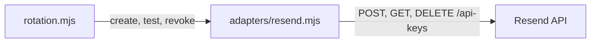

# Design Document

## Overview

Esta spec implementa o primeiro adaptador do núcleo `api-key-rotation`. Toda a lógica específica do Resend fica em um único arquivo, sem mudanças nas etapas da rotação.

**Depende de:** contrato do adaptador, Secrets Manager simulado e módulo Terraform do núcleo.

---

## Architecture



O adaptador não define `set`, pois a chave já nasce ativa.

---

## Components and Interfaces

| Arquivo | Mudança |
|---|---|
| `terraform/lambda/rotation/adapters/resend.mjs` | Novo: schemas e operações |
| `terraform/lambda/rotation/adapters/resend.test.mjs` | Novo: testes com `fetch` simulado |
| `terraform/lambda/rotation/adapters/index.mjs` | Registra `resend` |
| `terraform/variables.tf` | Acrescenta `resend` em `local.rotation_adapters` |
| `terraform/lambda.tf` | Exclui `adapters/resend.test.mjs` do pacote |
| `terraform/examples/basic/` | Instância com `service_name = "resend"` |
| `README.md` | Seção do Resend |

### Operações

| Operação | Chamada | Bearer | Resultado |
|---|---|---|---|
| `create({ current, now })` | `POST /api-keys` com `{ name: "nexuskey-<UTC>", permission: "full_access" }` | `current.api_key` | `{ api_key: token, key_id: id }` |
| `test({ pending })` | `GET /api-keys` | `pending.api_key` | Lança em falha |
| `revoke({ previous, current })` | `DELETE /api-keys/{previous.key_id}` | `current.api_key` | `"revoked"` ou `"already-revoked"` (404) |

- **Timeout:** todas as chamadas usam `AbortSignal.timeout(10_000)`.
- **URL:** o `key_id` usa `encodeURIComponent`.
- **Nome da chave:** `nexuskey-YYYYMMDDTHHmmssZ`, dentro do limite de 50 caracteres.
- **Corpo não JSON:** tratado como falha, sem registrar o conteúdo.

---

## Data Models

```json
{ "api_key": "re_...", "key_id": "<id da chave>" }
```

| Schema | Campos |
|---|---|
| `secretSchema` | `api_key`: `^re_[A-Za-z0-9_]+$`, mínimo de 10 caracteres; `key_id`: string não vazia |
| `createKeySchema` | `id`, `object: "api_key"`, `token` |
| `listKeysSchema` | `object`, `has_more`, `data[]` com `id`, `name`, `created_at` (string não vazia, porque a documentação usa `2026-04-08 00:11:13.110779+00`, fora do padrão ISO) |
| `deleteKeySchema` | `object: "api_key"`, `id`, `deleted: true` |

---

## Error Handling

| Operação | Condição | Comportamento |
|---|---|---|
| `create` | Não 2xx, schema inválido, timeout ou rede | Lança; o núcleo não grava |
| `test` | Não 2xx, schema inválido, timeout ou rede | Lança; `AWSCURRENT` intacto |
| `revoke` | 404 | Retorna `"already-revoked"` |
| `revoke` | Outro não 2xx, schema inválido, timeout ou rede | Lança; o núcleo encerra com erro |

Erros citam só a operação, o status HTTP, os nomes de campo e os códigos Zod, nunca tokens nem o payload.

---

## Testing Strategy

**Adaptador**, com `fetch` simulado:

- Formato real do token e das respostas da documentação.
- `POST` com `name`, `permission` e Bearer corretos.
- Cada caminho de falha, sem o token aparecer em mensagens de erro.
- `DELETE` com `key_id`, nunca com o token, e tratamento de 404.

**Integração:** o Resend real do adaptador, com `fetch` simulado, no Secrets Manager simulado do núcleo. Dois ciclos seguidos precisam revogar a chave certa em cada um.

**Teste real:** somente com confirmação do operador, em ambiente de teste e com chave de teste, nunca com a chave de produção usada pelo OTP. Falta ainda confirmar o status retornado pelo `DELETE`, que a documentação não especifica.
