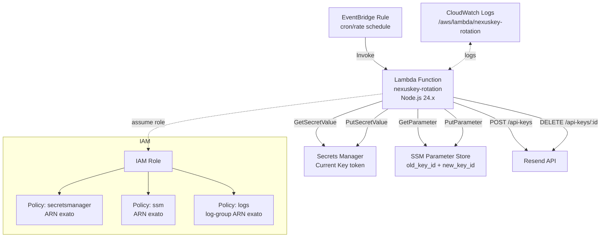
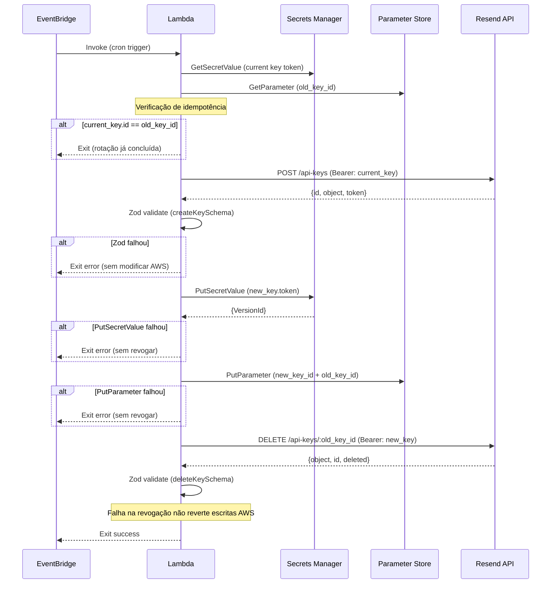

# Design Document

## Overview

O **NexusKey** é um módulo Terraform que provisiona uma arquitetura serverless na AWS para rotacionar automaticamente a chave de API do Resend. Uma Lambda Function (Node.js 24.x) é agendada pelo EventBridge com uma expressão `cron()` ou `rate()` configurável, executa o ciclo de rotação e encerra sem depender de intervenção humana.

O ciclo de rotação segue um fluxo sequencial com semântica de falha-segura: **Gerar → Validar → Persistir → Revogar**. Cada etapa só avança se a anterior foi concluída com sucesso. Em qualquer falha, a chave antiga permanece intacta na AWS e na Resend API. Nenhum valor de chave trafega pelo Terraform state.

### Objetivos de design

- **Segurança por padrão**: chaves ficam exclusivamente no Secrets Manager; o Parameter Store armazena apenas identificadores (`id`) não sensíveis.
- **Idempotência**: a Lambda detecta execuções duplicadas comparando o `id` ativo com o `old_key_id` no Parameter Store e encerra sem efeito colateral.
- **Privilégio mínimo**: a IAM Role possui exatamente três políticas inline com ARNs exatos — sem wildcards em nenhum elemento `Resource`.
- **Separação de responsabilidades**: a lógica de negócio (`rotation.mjs`) recebe dependências injetadas, tornando-a testável de forma isolada.

---

## Architecture



### Fluxo de rotação passo a passo



---

## Components and Interfaces

### Terraform — Recursos provisionados

| Arquivo | Recurso Terraform | Propósito |
|---|---|---|
| `main.tf` | `aws_secretsmanager_secret` | Cria o container do segredo (sem `secret_version`) |
| `main.tf` | `aws_ssm_parameter` | Parâmetro para `old_key_id` e `new_key_id` (tipo `String`) |
| `main.tf` | `aws_cloudwatch_log_group` | Grupo de logs `/aws/lambda/<function_name>` com retenção configurável |
| `iam.tf` | `aws_iam_role` | Role de execução da Lambda com `assume_role_policy` para `lambda.amazonaws.com` |
| `iam.tf` | `aws_iam_role_policy` × 3 | Políticas inline: Secrets Manager, SSM, CloudWatch Logs |
| `eventbridge.tf` | `aws_cloudwatch_event_rule` | Regra de agendamento com `schedule_expression` |
| `eventbridge.tf` | `aws_cloudwatch_event_target` | Target apontando para a Lambda |
| `eventbridge.tf` | `aws_lambda_permission` | Permite que o EventBridge invoque a Lambda |
| `lambda.tf` | `data.archive_file` | Empacota o diretório `lambda/rotation/` em `.zip` |
| `lambda.tf` | `aws_lambda_function` | Função Lambda com runtime `nodejs24.x`, timeout 300s |

### Lambda — Módulos JavaScript

#### `index.mjs` — Handler e bootstrap

Ponto de entrada da Lambda. Responsável por:
- Instanciar os clientes AWS SDK (`SecretsManagerClient`, `SSMClient`).
- Buscar o token atual do Secrets Manager e o `old_key_id` do Parameter Store.
- Injetar dependências na função `rotate()` de `rotation.mjs`.
- Propagar erros para o runtime da Lambda (log de classe do erro, sem stack trace nem payload).

```
export const handler = async (event) => {
  // 1. Inicializa clientes AWS SDK v3
  // 2. Busca current_key_token do Secrets Manager
  // 3. Busca old_key_id do Parameter Store
  // 4. Chama rotate({ currentKeyToken, oldKeyId, deps })
  // 5. Captura exceção: loga somente erro.name + mensagem estática
}
```

#### `rotation.mjs` — Lógica de rotação (injeção de dependências)

Recebe um objeto `deps` com as funções de I/O injetadas, permitindo testes unitários sem mocks de AWS SDK.

```
export async function rotate({ currentKeyToken, oldKeyId, deps }) {
  const { callResendApi, putSecret, putParameter, getCurrentKeyId } = deps

  // 1. Idempotência: getCurrentKeyId() === oldKeyId → return early
  // 2. POST /api-keys → validate createKeySchema
  // 3. PutSecretValue(new_key.token) → assert VersionId não nulo
  // 4. PutParameter(new_key.id, oldKeyId) 
  // 5. DELETE /api-keys/:oldKeyId → validate deleteKeySchema (falha = warning, não erro)
}
```

**Assinatura das dependências injetadas:**

| Função | Contrato |
|---|---|
| `callResendApi(method, path, bearerToken, body?)` | Retorna `{ status, data }`. Lança em timeout ou erro de rede. |
| `putSecret(secretArn, value)` | Retorna `{ VersionId }`. Lança em falha AWS. |
| `putParameter(parameterArn, value)` | Retorna `void`. Lança em falha AWS. |
| `getCurrentKeyId(secretArn)` | Retorna `string` (id extraído da metada do segredo, ou valor guardado). |

#### `schema.mjs` — Schemas Zod

Exporta três schemas validados antes de qualquer operação de escrita:

```javascript
// createKeySchema — POST /api-keys response
export const createKeySchema = z.object({
  id: z.string().min(1),
  object: z.literal("api_key"),
  token: z.string().regex(/^re_[A-Za-z0-9_]+$/).min(10),
})

// listKeysSchema — GET /api-keys response
export const listKeysSchema = z.object({
  object: z.string(),
  has_more: z.boolean(),
  data: z.array(z.object({
    id: z.string().min(1),
    name: z.string(),
    created_at: z.string().datetime(),
  })),
})

// deleteKeySchema — DELETE /api-keys/{id} response
export const deleteKeySchema = z.object({
  object: z.literal("api_key"),
  id: z.string().min(1),
  deleted: z.literal(true),
})
```

#### `rotation.test.mjs` — Testes unitários

Testes com Node.js built-in test runner (`node:test` + `node:assert`). Todas as dependências de I/O são injetadas como funções mock, sem SDK AWS real e sem chamadas de rede.

---

## Data Models

### Secrets Manager — valor do segredo

O segredo armazena exclusivamente o **token bruto** da chave Resend como string simples (plaintext):

```
re_AbCdEfGh1234567890
```

- Formato: string correspondendo a `^re_[A-Za-z0-9_]+$` com mínimo de 10 caracteres.
- O Terraform cria o recurso `aws_secretsmanager_secret` **sem** declarar `aws_secretsmanager_secret_version`. O valor inicial deve ser configurado fora do Terraform (console, CLI, CI/CD pipeline) para evitar que apareça no state.

### SSM Parameter Store — parâmetro de metadados

O parâmetro SSM armazena um objeto JSON com os identificadores das chaves (nunca os tokens):

```json
{
  "new_key_id": "abc123def456",
  "old_key_id": "xyz789uvw012"
}
```

- Tipo SSM: `String` (não `SecureString`, pois são apenas IDs não sensíveis).
- Atualizado a cada ciclo bem-sucedido, com `Overwrite = true`.

### Variáveis Terraform

| Variável | Tipo | Obrigatória | Padrão | Validação |
|---|---|---|---|---|
| `secret_arn` | `string` | Sim | — | não vazio |
| `parameter_arn` | `string` | Sim | — | não vazio |
| `rotation_schedule` | `string` | Sim | — | `^(rate\|cron)\(` |
| `function_name` | `string` | Não | `"nexuskey-rotation"` | máx. 64 chars |
| `log_retention_days` | `number` | Não | `30` | conjunto CloudWatch aceito |
| `tags` | `map(string)` | Não | `{}` | — |

### Outputs Terraform

| Output | Tipo | `sensitive` | Descrição |
|---|---|---|---|
| `lambda_function_arn` | `string` | `false` | ARN da Lambda Function |
| `lambda_function_name` | `string` | `false` | Nome da Lambda Function |
| `secret_arn` | `string` | `true` | ARN do segredo no Secrets Manager |
| `log_group_name` | `string` | `false` | Nome do grupo de logs CloudWatch |

---

## Error Handling

### Princípio geral

Cada etapa do ciclo verifica sua própria pré-condição antes de avançar. Uma falha encerra o ciclo imediatamente com erro, **sem** tentar reverter etapas anteriores, **exceto** que a revogação da chave antiga nunca ocorre se qualquer etapa anterior falhou.

### Tabela de falhas e comportamento

| Etapa | Condição de falha | Comportamento |
|---|---|---|
| Buscar token atual (SM) | `GetSecretValue` lança exceção | Lambda encerra com erro; ciclo não iniciado |
| Buscar old_key_id (SSM) | `GetParameter` lança exceção | Lambda encerra com erro; ciclo não iniciado |
| POST /api-keys | Timeout (10s) ou erro de rede | Lambda encerra com erro; nenhum recurso AWS modificado |
| POST /api-keys | Status HTTP não 2xx | Lambda encerra com erro; nenhum recurso AWS modificado |
| Zod validate (createKey) | Schema inválido | Lambda encerra com erro; nenhum recurso AWS modificado |
| PutSecretValue | Erro AWS ou VersionId nulo | Lambda encerra com erro; chave antiga não revogada |
| PutParameter | Erro AWS | Lambda encerra com erro; Secrets Manager já atualizado; chave antiga não revogada |
| DELETE /api-keys | Timeout (10s), erro de rede ou HTTP não 2xx | Lambda encerra com **sucesso** + log de aviso |
| Zod validate (deleteKey) | Schema inválido | Lambda encerra com **sucesso** + log de aviso |
| DELETE /api-keys | HTTP 404 (já revogada) | Lambda encerra com **sucesso** (idempotência) |

### Política de logs

- **Nunca** registrar: tokens (`re_...`), payloads brutos da Resend API, stack traces, valores de chaves.
- **Permitido registrar**: nome do campo inválido, tipo esperado, nome da classe do erro (`error.name`), mensagens estáticas de progresso.
- Formato JSON via `logging_config { log_format = "JSON" }` na Lambda.

### Tratamento de exceções não tratadas

O handler em `index.mjs` envolve toda a execução em `try/catch`:

```javascript
catch (err) {
  console.error(JSON.stringify({
    error: err.name,           // somente nome da classe
    step: currentStep,         // string estática (ex: "put-secret")
  }))
  throw err                    // relança para Lambda reportar falha
}
```

---

## Testing Strategy

Esta feature combina infraestrutura Terraform (IaC) com lógica de negócio JavaScript na Lambda. As estratégias de teste são diferenciadas por camada.

### Camada Lambda (JavaScript) — Testes unitários com injeção de dependências

O módulo `rotation.mjs` recebe todas as dependências de I/O como parâmetros, permitindo testes determinísticos sem AWS SDK real nem chamadas de rede.

**Framework**: Node.js built-in test runner (`node:test` + `node:assert`) — sem dependência adicional além de `zod`.

**Escopo dos testes:**

1. **Schemas Zod** (`schema.mjs`):
   - Validação positiva: payloads válidos de criação, listagem e deleção.
   - Validação negativa: campo ausente, tipo errado, literal errado, token com formato inválido.

2. **Fluxo de rotação** (`rotation.mjs`):
   - **Caminho feliz**: nova chave criada, secrets manager atualizado, parameter store atualizado, chave antiga revogada.
   - **Idempotência**: `current_key.id === old_key_id` → retorna sem efeito colateral.
   - **Idempotência parcial**: `current_key.id !== old_key_id` e SM já atualizado → pula geração, vai direto para revogação.
   - **DELETE 404**: chave já revogada → encerra com sucesso.
   - **Falha no Zod (criação)**: nenhuma chamada a `putSecret` ou `putParameter`.
   - **Falha no PutSecretValue**: nenhuma chamada a `putParameter` nem a `callResendApi` (DELETE).
   - **Falha no PutParameter**: nenhuma chamada a `callResendApi` (DELETE).
   - **Falha na revogação (DELETE não 2xx)**: função retorna sem erro (warning apenas).

### Camada Terraform (IaC) — Validação estática

Property-based testing não é aplicável a IaC declarativo. A estratégia de validação é:

- **`terraform validate`**: verifica sintaxe, tipos e regras de validação das variáveis.
- **`terraform plan`** (com `tfvars.example`): valida que o plano não inclui `aws_secretsmanager_secret_version` e não usa wildcards em `Resource`.
- Revisão manual do arquivo `iam.tf` para confirmar ausência de `*` em todos os elementos `Resource`.

### Por que PBT não se aplica à camada Lambda

A lógica de `rotation.mjs` é composta predominantemente de **fluxo de controle sequencial com efeitos colaterais** (chamadas de rede e AWS SDK), não de transformações de dados puras com espaço de entrada variado. Os casos de teste relevantes são cenários discretos e bem definidos (caminho feliz, cada ponto de falha, idempotência) — não um espaço contínuo que se beneficiaria de geração aleatória de inputs.

A validação Zod em `schema.mjs` é a porção mais próxima de lógica pura, mas os schemas são fixos e os casos de borda (campo ausente, literal errado, regex do token) são melhor cobertos por exemplos concretos que documentam o contrato da API.
