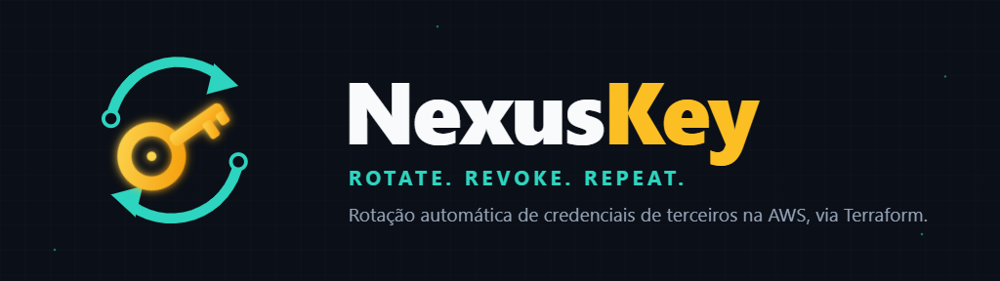

# NexusKey

<p align="center">
  
</p>

O **NexusKey** é um módulo Terraform que provisiona na AWS o segredo de um serviço externo e a rotação automática da credencial, usando a rotação nativa do Secrets Manager.

Você executa o Terraform na sua máquina apenas para provisionar. Depois disso, a rotação roda na AWS, sem depender dessa máquina. A aplicação só lê o valor atual do segredo.

## O que é criado

Cada serviço usa uma instância do módulo, com um segredo em JSON:

| Recurso | Quando |
|---|---|
| Segredo `nexuskey/<service_name>` | Sempre |
| Política de leitura `nexuskey-<service_name>-secret-read` | Sempre |
| Lambda `nexuskey-<service_name>-rotation`, role, logs e agendamento | Com `enable_rotation = true` |

## Pré-requisitos

- Terraform na versão de [`.terraform-version`](.terraform-version).
- Node.js 24 e AWS CLI.
- Credenciais AWS na sua máquina, com permissão para gerenciar Secrets Manager, IAM, Lambda e CloudWatch Logs.
- Antes de cada `apply` com rotação, instale as dependências que vão no pacote da Lambda.

## Como rodar

Este é o caminho recomendado para o primeiro uso, com o Resend e no PowerShell. Ele usa uma chave dedicada, para que a aplicação continue funcionando com a chave atual caso algo falhe. Nunca coloque a chave em arquivo, em comando ou em conversa.

### 1. Prepare o ambiente

No painel do Resend, crie uma chave `full_access` só para o NexusKey e anote o token e o ID. Não use a chave que a aplicação usa hoje.

Depois, na raiz do repositório:

```powershell
terraform version              # deve ser a versão de .terraform-version
aws sts get-caller-identity    # confirme que é a conta da aplicação
cd terraform\lambda\rotation
npm ci --omit=dev
cd ..\..\examples\basic
Copy-Item terraform.tfvars.example terraform.tfvars
```

Em `terraform.tfvars`, informe a região da aplicação, `initial_secret_version = 1` e mantenha `enable_rotation = false`.

### 2. Crie o segredo

```powershell
$valor = Read-Host -AsSecureString
```

Digite o JSON em uma linha, no formato `{"api_key":"re_...","key_id":"<ID>"}`. Em seguida:

```powershell
$env:TF_VAR_initial_secret = [Net.NetworkCredential]::new('', $valor).Password
terraform init
terraform plan
```

Aplique somente se o plano mostrar `3 to add, 0 to change, 0 to destroy`:

```powershell
terraform apply
Remove-Item Env:TF_VAR_initial_secret
Remove-Variable valor
Select-String -Path terraform.tfstate -Pattern '"re_'
```

O `Select-String` não pode retornar nada. Se retornar, a chave foi para o state: pare antes de continuar.

### 3. Ative a rotação

Em `terraform.tfvars`, use `enable_rotation = true` e confira `rotation_schedule`. Depois, rode:

```powershell
terraform plan
```

Aplique com `terraform apply` somente se o plano mostrar `7 to add, 0 to change, 0 to destroy`. Se aparecer mudança ou destruição na versão do segredo, ou um erro por falta de valor, pare sem aplicar.

### 4. Comprove a rotação

Como a aplicação ainda não lê o segredo, ela não é afetada por estes testes:

```powershell
aws secretsmanager rotate-secret --secret-id nexuskey/resend
```

Aguarde cerca de 1 minuto e confira:

```powershell
aws secretsmanager describe-secret --secret-id nexuskey/resend --query VersionIdsToStages
aws logs tail /aws/lambda/nexuskey-resend-rotation --since 15m
terraform plan
```

O resultado esperado é:

- uma nova versão em `AWSCURRENT` e a anterior em `AWSPREVIOUS`;
- a chave dedicada revogada no painel do Resend e uma chave `nexuskey-<data e hora UTC>` criada;
- `terraform plan` sem alterações.

Repita o passo uma vez, para comprovar dois ciclos seguidos.

### 5. Migre a aplicação

1. Anexe à role da aplicação a política de `terraform output reader_policy_arn`.
2. Publique a aplicação lendo `nexuskey/resend`, conforme a seção [Resend](#resend).
3. Confirme que o envio de e-mails funciona, inclusive o de códigos OTP.
4. Rode `rotate-secret` de novo e confirme que o envio continua funcionando.
5. Só então revogue no painel a chave antiga da aplicação.

### Se algo der errado

- **Antes da migração:** a aplicação não é afetada. Para parar a rotação, use `enable_rotation = false`, rode `terraform apply` e revogue no painel as chaves que sobrarem.
- **Durante a migração:** volte a aplicação para a chave antiga, que só é revogada no fim.
- **Com `AWSPENDING` remanescente:** siga [Recuperação de uma rotação com falha](#recuperação-de-uma-rotação-com-falha).

## Configuração inicial

Esta seção descreve cada etapa de forma geral, para qualquer serviço e também em Bash.

Execute a partir de um diretório raiz próprio, com base em [`terraform/examples/basic/`](terraform/examples/basic/). Copie `terraform.tfvars.example` para `terraform.tfvars` e ajuste os valores.

### 1. Provisione o segredo com a credencial atual

O valor entra por variável de ambiente, para não ficar em arquivo. Ele também não fica no state nem no plan.

```powershell
# PowerShell
$valor = Read-Host -AsSecureString
$env:TF_VAR_initial_secret = [Net.NetworkCredential]::new('', $valor).Password
terraform init
terraform apply -var="initial_secret_version=1"
Remove-Item Env:TF_VAR_initial_secret
```

```bash
# Bash
read -rs TF_VAR_initial_secret && export TF_VAR_initial_secret
terraform init
terraform apply -var="initial_secret_version=1"
unset TF_VAR_initial_secret
```

Mantenha `initial_secret_version = 1` no `terraform.tfvars` depois disso. **Nunca altere esse número depois de uma rotação,** pois isso regravaria um valor já revogado.

Se preferir não passar o valor pelo Terraform, deixe `initial_secret_version = 0` e grave pela CLI depois do `apply`:

```bash
aws secretsmanager put-secret-value --secret-id nexuskey/<service_name> --secret-string file://valor.json
```

Apague `valor.json` em seguida e não o versione.

### 2. Faça a aplicação ler o segredo

Anexe a política de leitura à identidade da aplicação e publique a versão que lê o segredo, conforme [Leitura pela aplicação](#leitura-pela-aplicação).

> **Se a credencial inicial for a mesma que a aplicação usa, faça isso antes de ativar a rotação.** A primeira rotação pode revogar a credencial inicial, e uma aplicação que ainda a use diretamente deixa de funcionar.

### 3. Ative a rotação

No `terraform.tfvars`:

```hcl
enable_rotation   = true
rotation_schedule = "rate(30 days)"
```

Depois, rode `terraform apply`. A AWS testa a configuração nesse momento. Uma validação entre variáveis, como rotação sem agenda ou sem adaptador, falha no `plan`.

### 4. Rotacione

A rotação segue a agenda. Para rodar agora, use o comando do output `rotate_command`:

```bash
aws secretsmanager rotate-secret --secret-id nexuskey/<service_name>
```

O comando só inicia a rotação, que termina em segundo plano. Acompanhe pelos logs da Lambda, indicados no output `log_group_name`.

## Leitura pela aplicação

Mantenha o valor em cache por até 5 minutos e leia de novo ao receber um erro de autenticação do serviço. Com rotação, a credencial anterior pode ser revogada logo depois da troca.

```javascript
import { GetSecretValueCommand, SecretsManagerClient } from "@aws-sdk/client-secrets-manager"

const client = new SecretsManagerClient({})
const TTL_MS = 5 * 60 * 1000
const cache = new Map()

export async function getSecret(name, { refresh = false } = {}) {
  const hit = cache.get(name)
  if (!refresh && hit && Date.now() - hit.readAt < TTL_MS) return hit.value

  const { SecretString } = await client.send(new GetSecretValueCommand({ SecretId: name }))
  const value = JSON.parse(SecretString)
  cache.set(name, { value, readAt: Date.now() })
  return value
}
```

A aplicação usa a própria role da AWS, sem credenciais fixas. Anexe a ela a política do output `reader_policy_arn`.

## Execução local e state

- O state fica em `terraform.tfstate`, no diretório onde você roda o Terraform, e é ignorado pelo Git.
- Ele não guarda o valor do segredo, mas guarde uma cópia: sem ele, o Terraform perde o controle dos recursos. Para mais de uma pessoa ou máquina, use um backend remoto.
- `*.tfvars` também é ignorado pelo Git. Nunca coloque o valor do segredo nesse arquivo.

## Recuperação de uma rotação com falha

A AWS repete a rotação quando uma etapa falha. Se a falha persistir, a versão `AWSPENDING` pode ficar para trás e fazer a próxima rotação falhar.

1. Veja as versões e localize a que tem `AWSPENDING`:

   ```bash
   aws secretsmanager describe-secret --secret-id nexuskey/<service_name>
   ```

2. Se a versão tiver valor, a credencial que ela contém pode continuar ativa no serviço. Leia o valor, sem salvá-lo em arquivo, e revogue essa credencial no serviço:

   ```bash
   aws secretsmanager get-secret-value --secret-id nexuskey/<service_name> --version-stage AWSPENDING
   ```

3. Remova o rótulo:

   ```bash
   aws secretsmanager update-secret-version-stage --secret-id nexuskey/<service_name> \
     --version-stage AWSPENDING --remove-from-version-id <id da versão>
   ```

4. Rode `rotate-secret` de novo. Não remova o rótulo de uma rotação ainda em andamento.

## Serviços disponíveis

### Resend

Use `service_name = "resend"`. O segredo se chama `nexuskey/resend` e tem este formato:

```json
{ "api_key": "re_...", "key_id": "<id da chave>" }
```

A chave inicial precisa ter permissão `full_access`, porque é ela que autoriza a criação da próxima. As chaves criadas na rotação têm a mesma permissão, e por isso a aplicação que lê o segredo também pode criar e apagar chaves. O nome de cada chave segue o formato `nexuskey-<data e hora UTC>`.

> **A primeira rotação revoga a chave inicial.** Se a aplicação ainda a estiver usando diretamente, o envio de e-mails para, inclusive o dos códigos OTP de login. Use uma chave inicial dedicada ou faça a aplicação ler o segredo antes de `enable_rotation = true`.

Leia o campo `api_key` e leia o segredo de novo ao receber HTTP 401, usando o `getSecret` de [Leitura pela aplicação](#leitura-pela-aplicação):

```javascript
import { Resend } from "resend"
import { getSecret } from "./secrets.js"

export async function sendEmail(message) {
  const attempt = async (refresh) => {
    const { api_key } = await getSecret("nexuskey/resend", { refresh })
    return new Resend(api_key).emails.send(message)
  }

  const result = await attempt(false)
  return result.error?.statusCode === 401 ? attempt(true) : result
}
```

Confira o formato do erro na versão do SDK do Resend que a aplicação usa.

## Adicionar um serviço

Um serviço pode ter rotação automática se tiver uma API para criar ou rotacionar credenciais. Crie uma spec própria em `.kiro/specs/` e:

1. Implemente um adaptador em `terraform/lambda/rotation/adapters/`, com o contrato descrito em [`adapters/index.mjs`](terraform/lambda/rotation/adapters/index.mjs).
2. Registre o adaptador em `adapters/index.mjs` e o nome do serviço em `local.rotation_adapters`, em [`variables.tf`](terraform/variables.tf).
3. Exclua os testes do adaptador do pacote, em [`lambda.tf`](terraform/lambda.tf).
4. Crie outra instância do módulo, com o novo `service_name`.

Sem essa API, use a instância com `enable_rotation = false`: a troca continua manual, mas a aplicação lê tudo do mesmo lugar.

## Desenvolvimento

```bash
node --test terraform/lambda/rotation/rotation.test.mjs terraform/lambda/rotation/adapters/resend.test.mjs
terraform -chdir=terraform validate
terraform -chdir=terraform/examples/basic validate
```

As regras de trabalho e o fluxo de specs estão em [`AGENTS.md`](AGENTS.md).
